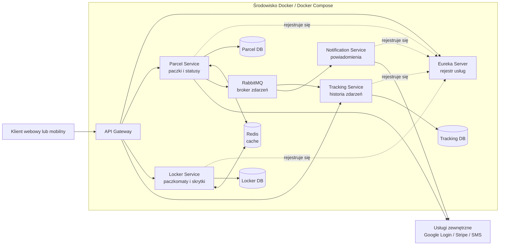

# Makieta architektury systemu mikroserwisowego

## Przykład: system paczkomatów

Ten dokument pokazuje, jak technologie wymienione w sylabusie współpracują ze sobą w jednym projekcie.

## 1. Widok ogólny



## 2. Rola poszczególnych elementów

| Element | Rola w systemie |
|---|---|
| API Gateway | Jeden punkt wejścia dla klienta; kieruje żądania do właściwej usługi |
| Eureka Server | Rejestruje usługi i pozwala je odnajdywać po nazwie |
| Parcel Service | Zarządza paczkami i ich statusami |
| Locker Service | Zarządza paczkomatami, skrytkami i ich dostępnością |
| Tracking Service | Przechowuje historię zmian statusów |
| Notification Service | Wysyła informacje do użytkowników |
| RabbitMQ | Przekazuje zdarzenia między usługami |
| Redis | Przechowuje często używane dane tymczasowe |
| Bazy danych | Każda usługa przechowuje własne dane |
| Docker | Uruchamia usługi jako odseparowane kontenery |
| Usługi zewnętrzne | Dostarczają funkcje, których nie implementujemy samodzielnie |

## 3. Komunikacja synchroniczna

Klient pyta o status paczki:

```text
Klient
  |
  v
API Gateway
  |
  | wyszukuje Parcel Service w Eurece
  v
Parcel Service
  |
  v
Parcel DB
```

Przykładowe żądanie:

```http
GET /api/parcels/PCK-123
```

Klient nie musi znać adresu ani portu `Parcel Service`. Zna tylko adres Gatewaya.

## 4. Komunikacja asynchroniczna

Kurier umieszcza paczkę w skrytce:

```text
Parcel Service
      |
      | publikuje zdarzenie ParcelPlaced
      v
RabbitMQ
      |
      +--> Tracking Service
      |       zapisuje historię
      |
      +--> Notification Service
              wysyła powiadomienie
```

Przykładowe zdarzenie:

```json
{
  "event": "ParcelPlaced",
  "parcel_id": "PCK-123",
  "locker_id": "KRK-1024",
  "compartment_id": "L-17",
  "occurred_at": "2026-10-05T10:15:00Z"
}
```

`Parcel Service` nie musi czekać, aż powiadomienie zostanie wysłane. Dzięki temu awaria `Notification Service` nie musi blokować obsługi paczki.

## 5. Service discovery z Eureką

```text
Parcel Service  -- rejestruje nazwę i port --> Eureka Server
Locker Service  -- rejestruje nazwę i port --> Eureka Server

Parcel Service  -- pyta: gdzie jest Locker Service? --> Eureka Server
Parcel Service  ---------------- żądanie ----------> Locker Service
```

Eureka nie przechowuje danych paczek. Jest komponentem infrastruktury, który pomaga odnaleźć działające instancje usług.

## 6. Docker i fizyczne uruchomienie

Na początku wszystkie kontenery mogą działać na jednym komputerze:

```text
Jeden komputer
├── eureka-server
├── api-gateway
├── parcel-service
├── locker-service
├── tracking-service
├── notification-service
├── rabbitmq
└── redis
```

Później można rozdzielić elementy między komputery studentów:

```text
Komputer A — Parcel Service
Komputer B — Locker Service
Komputer C — Tracking Service
Komputer D — Notification Service
Komputer prowadzącego — Eureka, RabbitMQ, Gateway
```

Mikroserwis nie oznacza automatycznie osobnego fizycznego serwera. Najpierw ważne są osobne odpowiedzialności i procesy, a dopiero później rozproszenie fizyczne.

## 7. Przykładowy scenariusz awarii

```text
Notification Service — niedostępna

Parcel Service       — działa
Locker Service       — działa
Tracking Service     — działa
```

Użytkownik nadal może sprawdzić status paczki. Zdarzenie może pozostać w RabbitMQ i zostać obsłużone po powrocie usługi powiadomień.

Awaria może jednak mieć większy zasięg, jeśli przestanie działać:

- API Gateway,
- Eureka przy braku mechanizmu awaryjnego,
- RabbitMQ,
- wspólna baza lub wspólna usługa uwierzytelniania.

## 8. Wersja minimalna na zajęcia

Na początku wystarczą:

```text
API Gateway
Eureka Server
Parcel Service
Locker Service
RabbitMQ
Docker Compose
```

Następnie można dodać:

1. osobne bazy danych,
2. Redis,
3. Tracking Service,
4. Notification Service,
5. komunikację z usługą zewnętrzną,
6. uruchamianie usług na różnych komputerach.

